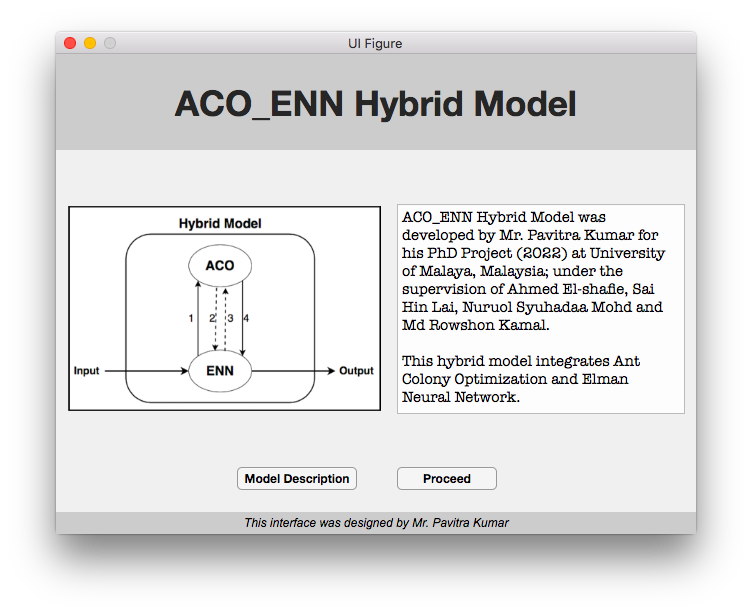
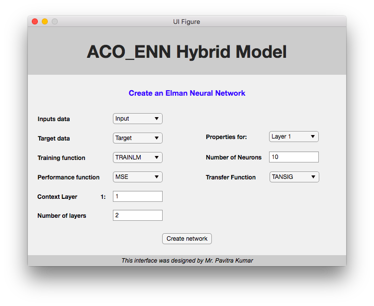
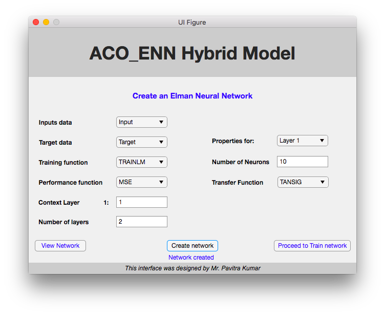
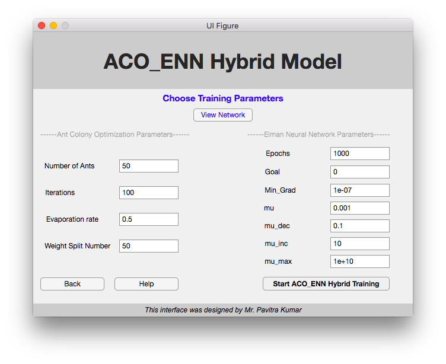
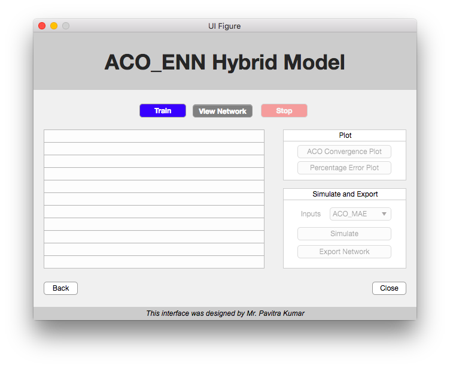
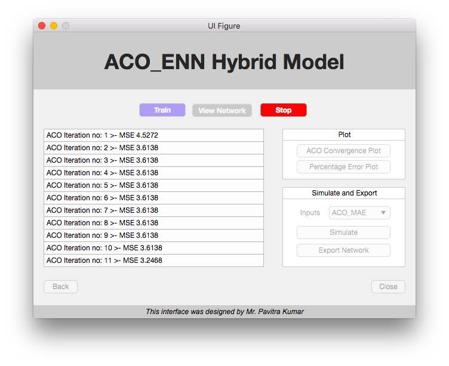
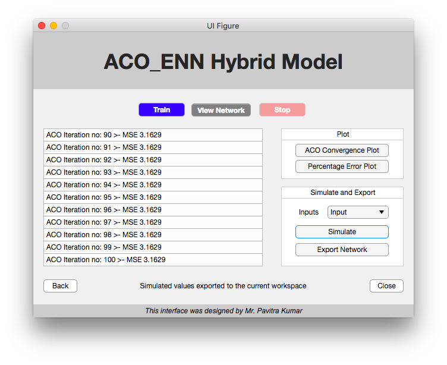
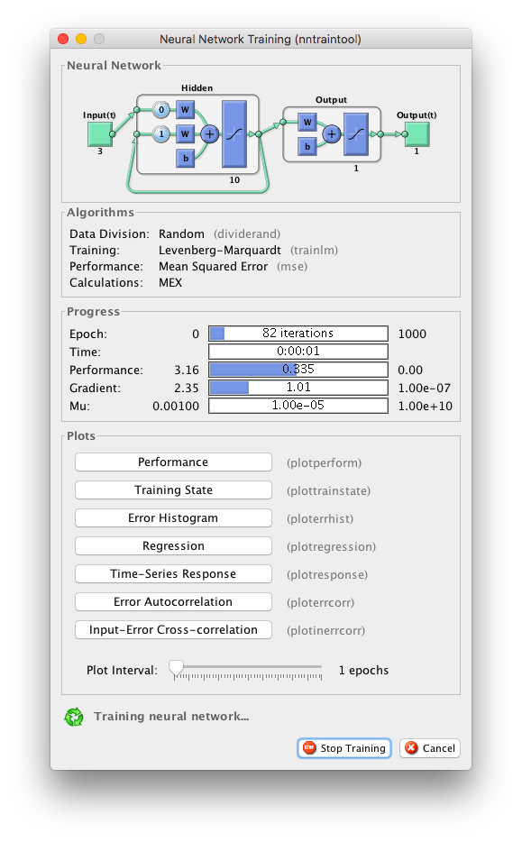
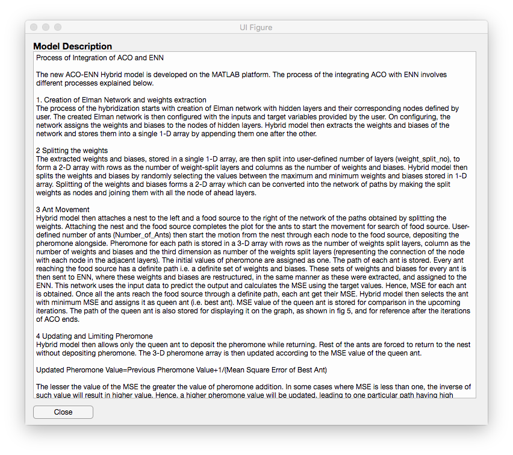

# 🌬️ ACO-ENN Hybrid Model
ACO-ENN is a hybrid model created using Ant Colony Optimization (ACO) algorithm for optimizing the weights of Elman Neural Network (ENN). This repository contains a MATLAB-based application that helps user to create and train the ACO-ENN hybrid model based on user's configuration and data. The final model after training can be exported and saved at the desired location. The details of the hybrid model development algorithm can be found in the application ("Model Description" button) or in the published manuscript https://doi.org/10.1080/19942060.2021.1990134.

"Deep Learning Toolbox" is required to be installed in MATLAB to run this application.

## 🖥️ Application Preview

### 1. Launch Page

### 2. Model configuration

### 3. Model creation

### 4. Training parameters

### 5. Model training (blank page)

### 6. Model training

### 7. Prediction

### 8. Model training window

### 9. Model description

